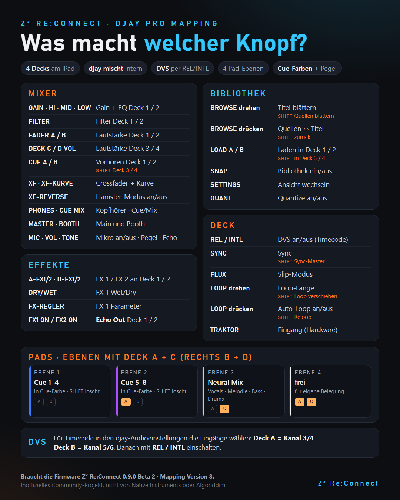

# Z2-Re:Connect

**Den Native Instruments Traktor Kontrol Z2 ohne Treiber am iPad und iPhone nutzen: Audio und USB-MIDI.**
Zum Beispiel mit djay Pro (4 Decks, DVS), mit vier Pad-Ebenen pro Deck, Cue-Farben auf den Pads und Pegelanzeigen.

*English summary below.*

> **Privates Hobby-Projekt ohne kommerziellen Hintergrund. Kein Produkt von Native Instruments oder Algoriddim.
> Benutzung auf eigene Gefahr, ohne jede Gewähr.** Aktueller Stand: **0.9.0 Beta 2**, ein öffentlicher Testlauf.

## Herunterladen und installieren
Die fertigen Programme liegen unter **[Releases](../../releases)** (rechts auf dieser Seite):

| Datei | Wofür |
|---|---|
| `Z2-ReConnect-0.9.0-beta2-Windows.zip` | Installer für Windows |
| `Z2-ReConnect-0.9.0-beta2-Mac.zip` | Installer für macOS (Apple Silicon und Intel) |
| `Z2-ReConnect-djay-Mapping-v8.zip` | passendes Mapping für djay Pro am iPad |

**Voraussetzungen:** Z2 mit Firmware 42 (letzte NI-Version) oder einer älteren Z2-Re:Connect-Version,
Z2 am Netzteil und per USB direkt am Rechner (kein Hub). Unter Windows muss der NI-Treiber für den Z2 installiert sein.

Der Installer liest zuerst die Firmware aus deinem Z2, **legt immer ein Backup an** und schreibt nur, wenn die
Firmware exakt der erwarteten Version entspricht. Mit dem Backup kommst du jederzeit zur Original-Firmware zurück.
Die ganze Anleitung steht in [`installer/LIESMICH.md`](installer/LIESMICH.md).

## Was ist drin?
| Ordner | Inhalt |
|---|---|
| `installer/` | Installer (Python, Fenster- und Textversion), Patch-Dateien, Build-Skripte |
| `firmware/` | Quelltext der neuen Firmware-Teile (USB-MIDI, Tasten → MIDI, MIDI → LEDs) und die Patch-Beschreibung |
| `tools/` | Werkzeuge für Entwickler: DFU-Flashen, Auslesen, HID- und MIDI-Tests, LED-Kalibrierung |
| `djay/` | djay-Mapping und das Skript, das es erzeugt |
| `grafik/` | Belegungsbilder (deutsch und englisch) |

Die MIDI-Belegung steht in [`firmware/README.md`](firmware/README.md).

## Rechtliches: keine NI-Firmware in diesem Repo
Dieses Repository enthält **keine Firmware von Native Instruments**. Die Patch-Dateien (`*.z2patch`, je unter 3 KB)
enthalten nur Kopier-Anweisungen und die neu geschriebenen Bytes. Die Original-Firmware kommt immer aus dem eigenen Gerät.
Backups (`*.z2backup`) enthalten die Original-Firmware und dürfen **nicht** weitergegeben werden.
„Native Instruments“, „Traktor“ und „Kontrol“ sind Marken von Native Instruments, „djay“ von Algoriddim.

## Rückmeldungen
Fehler, Fragen und Testberichte bitte als **[Issue](../../issues)** melden. Hilfreich sind: Betriebssystem, iPad/iPhone-Modell,
App, und was genau passiert ist.

## Lizenz
Eigener Code und eigene Dokumente: [MIT](LICENSE).

---

## English summary
Z2-Re:Connect is a firmware patch that makes the Native Instruments Traktor Kontrol Z2 work class-compliant on iPad and
iPhone, with audio **and** USB-MIDI (e.g. djay Pro with 4 decks, DVS, pad layers, cue colours, level meters).
Download the installer for Windows or macOS from **[Releases](../../releases)**; start it with `--lang en` or pick English
on the first page. It always backs up your current firmware first and only writes if your Z2 runs exactly NI firmware 42
(or an older Z2-Re:Connect build). No Native Instruments firmware is included in this repository. Hobby project, not
affiliated with Native Instruments or Algoriddim, no warranty, use at your own risk.
