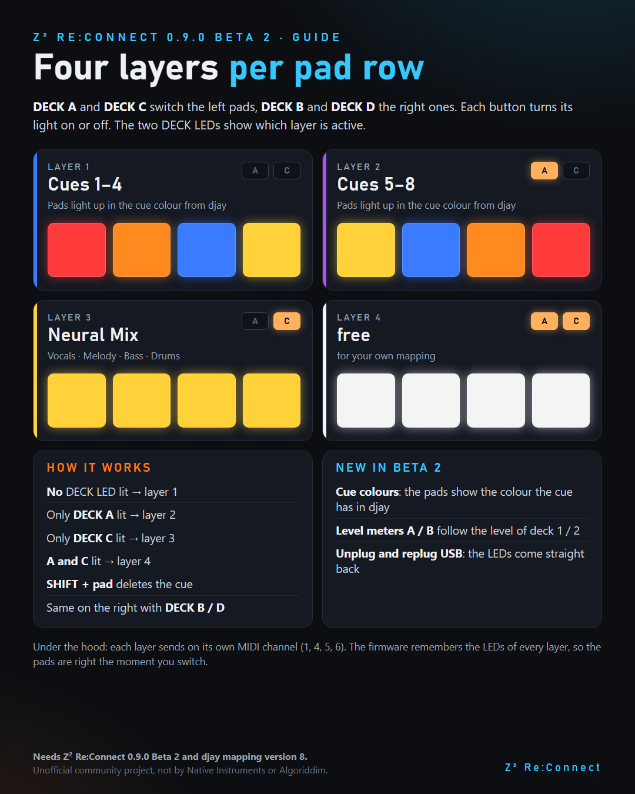
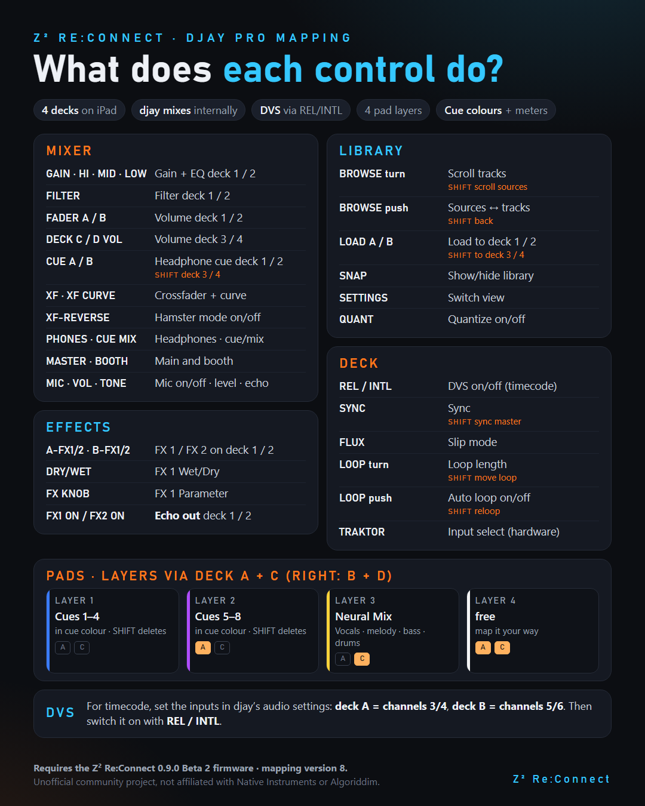

<h1 align="center">Re:Connect</h1>

  

## Z2-Re:Connect

**Use the Native Instruments Traktor Kontrol Z2 on iPad and iPhone without drivers: audio and USB-MIDI.**
For example with djay Pro (4 decks, DVS), with four pad layers per deck, cue colours on the pads and level meters.

*[Deutsche Version weiter unten](#deutsch)*

> **Private hobby project with no commercial background. Not a product of Native Instruments or Algoriddim.
> Use at your own risk, without any warranty.** Current version: **0.9.0 Beta 2**, a public test run.

> [!WARNING]
> **Known issues:** Z2 units with **factory firmware 51** are **not supported yet** (see below). The Mac version of the
> installer is experimental.

## Why this project?
I'm not a programmer or an IT specialist. I've been a DJ for many years and always loved my DJ gear, and it made me sad
that some devices simply can't be used anymore at some point. It's a real shame to watch good equipment gather dust until
it ends up in the bin.

That's how the idea for the **Re:Connect project** came about: breathing new life into old DJ and music hardware.
The Traktor Kontrol Z2 is the first device.

## Z2 units with firmware 51
Some Z2 units report **firmware 51**. NI's Device Updater shows *Newest Firmware 42* and *Installed Firmware 51*
with a green check mark. This is what we found out:

- These units shipped from the factory with firmware 51. A Z2 has two firmware slots: the factory firmware, which is
  never changed, and an update slot. On these units the **update slot is empty**, and the factory firmware cannot be read
  over USB. The installer therefore gets no data (error "The Z2 reports device version 51 ...").
- Z2-Re:Connect is a small patch on top of NI firmware 42 read from **your own device**. Without firmware 42 on the unit
  there is nothing to build from. The NI Device Updater does not install 42 on these units (tested by users).
- A diagnosis of a firmware-51 unit showed that its USB layout (audio, MIDI, controls, update interface) is **byte for
  byte identical** to a firmware-42 unit. The hardware is very likely the same.
- Supporting these units would mean distributing NI's complete firmware or extracting it from NI's software. Neither is
  done here for legal reasons. We are looking for a clean way, for example by asking Native Instruments.
- **Nothing is changed** on a firmware-51 unit: the installer stops before writing anything.

**How to check your unit:** open NI Device Updater. If *Installed Firmware* shows **42**, the installer works.
If it shows **51**, your unit is not supported yet. Feedback from firmware-51 owners is welcome as an issue.

## Download and install
The ready-to-use programs are under **[Releases](../../releases)** (on the right side of this page):

| File | What for |
|---|---|
| `Z2-ReConnect-0.9.0-beta2-Windows.zip` | Installer for Windows |
| `Z2-ReConnect-0.9.0-beta2-Mac.zip` | Installer for macOS (Apple Silicon and Intel) |
| `Z2-ReConnect-djay-Mapping-v8.zip` | Matching mapping for djay Pro on iPad |

**Requirements:** Z2 with firmware 42 (the last NI version) or an older Z2-Re:Connect version, Z2 connected to its power
supply and plugged directly into the computer via USB (no hub). On Windows, the NI driver for the Z2 must be installed.

The installer first reads the firmware from your Z2, **always makes a backup** and only writes if the firmware matches
the expected version exactly. With the backup you can go back to the original firmware at any time.
Start it with `--lang en` or pick English on the first page. The full guide (German) is in
[`installer/LIESMICH.md`](installer/LIESMICH.md).

## What's inside?
| Folder | Contents |
|---|---|
| `installer/` | Installer (Python, window and text version), patch files, build scripts |
| `firmware/` | Source code of the new firmware parts (USB-MIDI, buttons → MIDI, MIDI → LEDs) and the patch description |
| `djay/` | djay mapping and the script that generates it |
| `grafik/` | Control overview images (German and English) |

The MIDI assignment is described in [`firmware/README.md`](firmware/README.md) (German).

## Legal: no NI firmware in this repository
This repository contains **no firmware from Native Instruments**. The patch files (`*.z2patch`, each under 3 KB) only
contain copy instructions and the newly written bytes. The original firmware always comes from your own device.
Backups (`*.z2backup`) contain the original firmware and must **not** be shared.
"Native Instruments", "Traktor" and "Kontrol" are trademarks of Native Instruments, "djay" of Algoriddim.

## Feedback
Please report bugs, questions and test reports as an **[issue](../../issues)**. Helpful details: operating system,
iPad/iPhone model, app, and what exactly happened.

## License
Own code and own documents: [MIT](LICENSE).

---

# Z2-Re:Connect (Deutsch)

**Den Native Instruments Traktor Kontrol Z2 ohne Treiber am iPad und iPhone nutzen: Audio und USB-MIDI.**
Zum Beispiel mit djay Pro (4 Decks, DVS), mit vier Pad-Ebenen pro Deck, Cue-Farben auf den Pads und Pegelanzeigen.

> **Privates Hobby-Projekt ohne kommerziellen Hintergrund. Kein Produkt von Native Instruments oder Algoriddim.
> Benutzung auf eigene Gefahr, ohne jede Gewähr.** Aktueller Stand: **0.9.0 Beta 2**, ein öffentlicher Testlauf.

> [!WARNING]
> **Bekannte Probleme:** Z2 mit **Werks-Firmware 51** werden **noch nicht unterstützt** (siehe unten). Die Mac-Version
> des Installers ist experimentell.

## Warum dieses Projekt?
Ich bin kein Programmierer und kein IT-Spezialist, sondern lege seit vielen Jahren als DJ auf. Meine DJ-Hardware fand ich
immer toll, und es hat mich traurig gemacht, dass man manche Geräte irgendwann einfach nicht mehr benutzen kann. Es ist
sehr schade, guten Geräten beim Verstauben zuzusehen, bis sie am Ende auf dem Müll landen.

So ist die Idee zum **Re:Connect-Projekt** entstanden: alter DJ- und Musik-Hardware neues Leben einhauchen.
Der Traktor Kontrol Z2 ist das erste Gerät.

## Z2 mit Firmware 51
Manche Z2 melden **Firmware 51**. NIs Device Updater zeigt dann *Newest Firmware 42* und *Installed Firmware 51*
mit grünem Haken. Das haben wir herausgefunden:

- Diese Geräte haben ab Werk Firmware 51. Ein Z2 hat zwei Firmware-Plätze: die Werks-Firmware, die nie verändert wird,
  und einen Update-Platz. Bei diesen Geräten ist der **Update-Platz leer**, und die Werks-Firmware lässt sich über USB
  nicht auslesen. Der Installer bekommt deshalb keine Daten (Meldung „Der Z2 meldet die Geräteversion 51 …“).
- Z2-Re:Connect ist ein kleiner Patch auf NIs Firmware 42 aus dem **eigenen Gerät**. Ohne 42 im Gerät gibt es nichts,
  worauf er aufsetzen kann. NIs Device Updater spielt die 42 auf diesen Geräten nicht auf (von Nutzern getestet).
- Die Diagnose eines 51-Geräts zeigte: Der USB-Aufbau (Audio, MIDI, Bedienelemente, Update-Schnittstelle) ist
  **Byte für Byte identisch** mit einem 42-Gerät. Die Hardware ist sehr wahrscheinlich gleich.
- Um diese Geräte zu unterstützen, müsste man NIs komplette Firmware verteilen oder aus NIs Software herauslösen. Beides
  passiert hier aus rechtlichen Gründen nicht. Wir suchen nach einem sauberen Weg, zum Beispiel über eine Anfrage bei
  Native Instruments.
- An einem 51-Gerät wird **nichts verändert**: Der Installer bricht vor jedem Schreibzugriff ab.

**So prüfst du dein Gerät:** NIs Device Updater öffnen. Steht bei *Installed Firmware* **42**, funktioniert der Installer.
Steht dort **51**, wird dein Gerät noch nicht unterstützt. Rückmeldungen von 51-Besitzern gern als Issue.

## Herunterladen und installieren
Die fertigen Programme liegen unter **[Releases](../../releases)** (rechts auf dieser Seite):

| Datei | Wofür |
|---|---|
| `Z2-ReConnect-0.9.0-beta2-Windows.zip` | Installer für Windows |
| `Z2-ReConnect-0.9.0-beta2-Mac.zip` | Installer für macOS (Apple Silicon und Intel) |
| `Z2-ReConnect-djay-Mapping-v8.zip` | passendes Mapping für djay Pro am iPad |

**Voraussetzungen:** Z2 mit Firmware 42 (letzte NI-Version) oder einer älteren Z2-Re:Connect-Version,
Z2 am Netzteil und per USB direkt am Rechner (kein Hub). Unter Windows muss der NI-Treiber für den Z2 installiert sein.

Der Installer liest zuerst die Firmware aus deinem Z2, **legt immer ein Backup an** und schreibt nur, wenn die
Firmware exakt der erwarteten Version entspricht. Mit dem Backup kommst du jederzeit zur Original-Firmware zurück.
Die ganze Anleitung steht in [`installer/LIESMICH.md`](installer/LIESMICH.md).

## Was ist drin?
| Ordner | Inhalt |
|---|---|
| `installer/` | Installer (Python, Fenster- und Textversion), Patch-Dateien, Build-Skripte |
| `firmware/` | Quelltext der neuen Firmware-Teile (USB-MIDI, Tasten → MIDI, MIDI → LEDs) und die Patch-Beschreibung |
| `djay/` | djay-Mapping und das Skript, das es erzeugt |
| `grafik/` | Belegungsbilder (deutsch und englisch) |

Die MIDI-Belegung steht in [`firmware/README.md`](firmware/README.md).

## Rechtliches: keine NI-Firmware in diesem Repo
Dieses Repository enthält **keine Firmware von Native Instruments**. Die Patch-Dateien (`*.z2patch`, je unter 3 KB)
enthalten nur Kopier-Anweisungen und die neu geschriebenen Bytes. Die Original-Firmware kommt immer aus dem eigenen Gerät.
Backups (`*.z2backup`) enthalten die Original-Firmware und dürfen **nicht** weitergegeben werden.
„Native Instruments“, „Traktor“ und „Kontrol“ sind Marken von Native Instruments, „djay“ von Algoriddim.

## Rückmeldungen
Fehler, Fragen und Testberichte bitte als **[Issue](../../issues)** melden. Hilfreich sind: Betriebssystem, iPad/iPhone-Modell,
App, und was genau passiert ist.

## Lizenz
Eigener Code und eigene Dokumente: [MIT](LICENSE).
