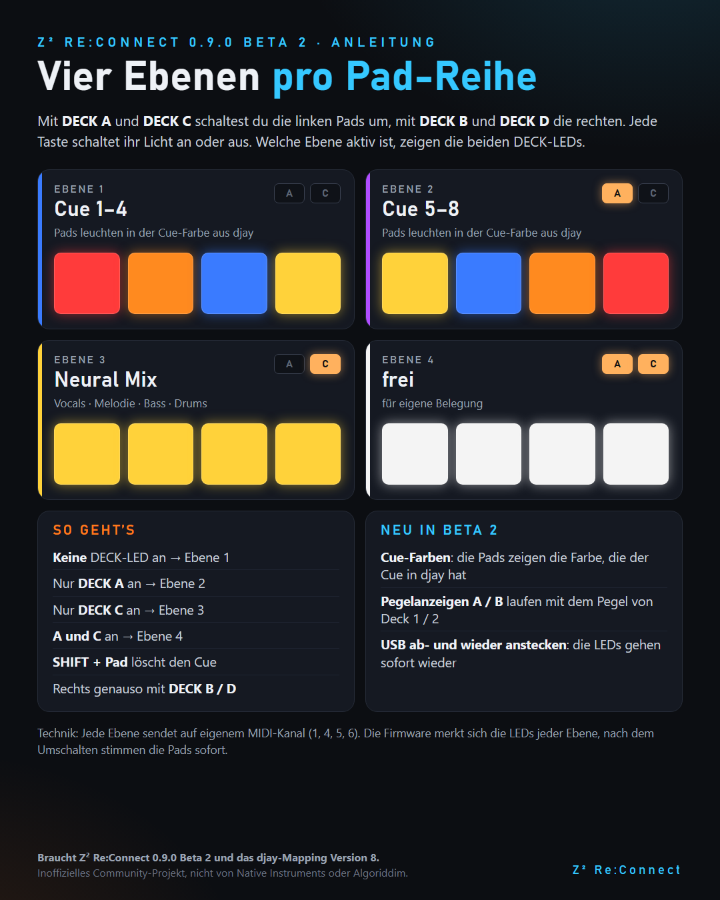

<h1 align="center">Re:Connect</h1>

  

## Z2-Re:Connect

**Use the Native Instruments Traktor Kontrol Z2 without drivers on iPad and iPhone, and as a standard USB device
probably also on Android, Mac and Linux: audio and USB-MIDI.**
For example with djay Pro (4 decks, DVS), with four pad layers per deck, cue colours on the pads and level meters.

| Device | Status |
|---|---|
| iPad, iPhone (djay Pro) | **tested** |
| Android, Mac, Linux | should work: the Z2 then reports itself as a standard USB device (USB Audio Class 2.0 + USB-MIDI). **Not tested yet.** On some Android devices only stereo may reach the apps; the device must support USB host (OTG). Feedback welcome. |

*[Deutsche Version weiter unten](#deutsch)*

> **Private hobby project with no commercial background. Not a product of Native Instruments or Algoriddim.
> Use at your own risk, without any warranty.** Current version: **0.9.0 Beta 2**, a public test run.

> [!WARNING]
> **Known issues:** Z2 units **without firmware 42** (factory firmware, empty update slot, e.g. "firmware 51") need the
> new **tester version** with an intermediate step (see below); on firmware 51 it is not tested yet. The Mac version of
> the installer is experimental.

## Why this project?
I'm not a programmer or an IT specialist. I've been a DJ for many years and always loved my DJ gear, and it made me sad
that some devices simply can't be used anymore at some point. It's a real shame to watch good equipment gather dust until
it ends up in the bin.

That's how the idea for the **Re:Connect project** came about: breathing new life into old DJ and music hardware.
The Traktor Kontrol Z2 is the first device.

## Z2 units without firmware 42 (factory firmware, e.g. "firmware 51")
Some Z2 units report **firmware 51** (or another factory version). NI's Device Updater shows *Newest Firmware 42* and
*Installed Firmware 51* with a green check mark and offers nothing.

- A Z2 has two firmware slots: the factory firmware, which is never changed, and an update slot. On these units the
  **update slot is empty**, and the factory firmware cannot be read over USB. The normal installer therefore gets no data.
- Z2-Re:Connect is a small patch on top of NI firmware 42 read from **your own device**. Without firmware 42 on the unit
  there is nothing to build from, and no NI firmware is ever distributed here.
- A diagnosis of a firmware-51 unit showed that its USB layout is **byte for byte identical** to a firmware-42 unit.

**New: the intermediate step (tester version, Windows).**
1. The tester installer writes a small, own **bridge firmware** into the empty update slot. It contains no NI code
   (its source code will be published later).
2. The bridge reports version 1. NI's own **Device Updater** then offers firmware 42 and installs it.
3. The installer is started again. It now finds firmware 42 and installs Z2-Re:Connect as usual.

**Way back:** switch the Z2 off and on up to four times. The bridge deletes itself and the factory firmware runs again.
Alternatively, hold SHIFT + SETTINGS for 5 s while switching on.

| Factory firmware | Status |
|---|---|
| 30 | whole path **proven on one unit** (November 2026) |
| 51 | **not tested yet**: the installer asks for an extra confirmation word |
| other | refused, nothing is written |

**Remaining risk:** if a unit has a flash chip the bridge does not know, it can hang on the bridge. Then only an SPI
programmer helps. Please only test if you accept that.

**How to check your unit:** open NI Device Updater. If *Installed Firmware* shows **42**, use the normal installer. If
it shows a factory version such as **51** or **30**, you need the tester version. Please report every test, also a
successful one, as an issue. Attach the files `Z2-ReConnect-Bridge-Protokoll.txt` and `Z2-ReConnect-Diagnose.txt` from
`Documents\Z2-Firmware-Backup` (no serial numbers, no firmware inside), the number under *Installed Firmware* and, if
possible, a photo of the memory chip.

## Download and install
The ready-to-use programs are under **[Releases](../../releases)** (on the right side of this page):

| File | What for |
|---|---|
| `Z2-ReConnect-0.9.0-beta2-Windows.zip` | Installer for Windows |
| `Z2-ReConnect-0.9.0-beta2-Mac.zip` | Installer for macOS (Apple Silicon and Intel) |
| `Z2-ReConnect-djay-Mapping-v8.zip` | Matching mapping for djay Pro on iPad |
| `Z2-ReConnect-0.9.0-beta2-Tester-Windows.zip` | **Tester version** with the intermediate step for units without firmware 42 (see above). Extract it first: the EXE and `z2rc_bridge.z2bridge` must be side by side. |

**Requirements:** Z2 with firmware 42 (the last NI version) or an older Z2-Re:Connect version, Z2 connected to its power
supply and plugged directly into the computer via USB (no hub). On Windows, the NI driver for the Z2 must be installed.

The installer first reads the firmware from your Z2, **always makes a backup** and only writes if the firmware matches
the expected version exactly. With the backup you can go back to the original firmware at any time.
Start it with `--lang en` or pick English on the first page. The full guide (German) is in
[`installer/LIESMICH.md`](installer/LIESMICH.md).

## What's inside?
| Folder | Contents |
|---|---|
| `installer/` | Installer (Python, window and text version), patch files, build scripts |
| `firmware/` | Source code of the new firmware parts (USB-MIDI, buttons → MIDI, MIDI → LEDs) and the patch description |
| `djay/` | djay mapping and the script that generates it |
| `grafik/` | Control overview images (German and English) |

The MIDI assignment is described in [`firmware/README.md`](firmware/README.md) (German).

## Legal: no NI firmware in this repository
This repository contains **no firmware from Native Instruments**. The patch files (`*.z2patch`, each under 3 KB) only
contain copy instructions and the newly written bytes. The original firmware always comes from your own device.
The bridge firmware is own code; with units without firmware 42, NI's own Device Updater installs firmware 42.
Backups (`*.z2backup`) contain the original firmware and must **not** be shared.
"Native Instruments", "Traktor" and "Kontrol" are trademarks of Native Instruments, "djay" of Algoriddim.

## Feedback
Please report bugs, questions and test reports as an **[issue](../../issues)**. Helpful details: operating system,
device model (iPad/iPhone/Android …), app, and what exactly happened.

## License
Own code and own documents: [MIT](LICENSE).

---

# Z2-Re:Connect (Deutsch)

**Den Native Instruments Traktor Kontrol Z2 ohne Treiber am iPad und iPhone nutzen und als Standard-USB-Gerät
wahrscheinlich auch an Android, Mac und Linux: Audio und USB-MIDI.**
Zum Beispiel mit djay Pro (4 Decks, DVS), mit vier Pad-Ebenen pro Deck, Cue-Farben auf den Pads und Pegelanzeigen.

| Gerät | Stand |
|---|---|
| iPad, iPhone (djay Pro) | **getestet** |
| Android, Mac, Linux | sollte gehen: Der Z2 meldet sich dann als Standard-USB-Gerät (USB Audio Class 2.0 + USB-MIDI). **Noch nicht getestet.** Bei manchen Android-Geräten kommt eventuell nur Stereo bei den Apps an; das Gerät muss USB-Host (OTG) können. Rückmeldungen erwünscht. |

> **Privates Hobby-Projekt ohne kommerziellen Hintergrund. Kein Produkt von Native Instruments oder Algoriddim.
> Benutzung auf eigene Gefahr, ohne jede Gewähr.** Aktueller Stand: **0.9.0 Beta 2**, ein öffentlicher Testlauf.

> [!WARNING]
> **Bekannte Probleme:** Z2 **ohne Firmware 42** (Werks-Firmware, leerer Update-Platz, z. B. „Firmware 51“) brauchen
> die neue **Tester-Version** mit Zwischenschritt (siehe unten); bei Firmware 51 ist sie noch nicht getestet. Die
> Mac-Version des Installers ist experimentell.

## Warum dieses Projekt?
Ich bin kein Programmierer und kein IT-Spezialist, sondern lege seit vielen Jahren als DJ auf. Meine DJ-Hardware fand ich
immer toll, und es hat mich traurig gemacht, dass man manche Geräte irgendwann einfach nicht mehr benutzen kann. Es ist
sehr schade, guten Geräten beim Verstauben zuzusehen, bis sie am Ende auf dem Müll landen.

So ist die Idee zum **Re:Connect-Projekt** entstanden: alter DJ- und Musik-Hardware neues Leben einhauchen.
Der Traktor Kontrol Z2 ist das erste Gerät.

## Z2 ohne Firmware 42 (Werks-Firmware, z. B. „Firmware 51“)
Manche Z2 melden **Firmware 51** (oder eine andere Werks-Version). NIs Device Updater zeigt dann *Newest Firmware 42*
und *Installed Firmware 51* mit grünem Haken und bietet nichts an.

- Ein Z2 hat zwei Firmware-Plätze: die Werks-Firmware, die nie verändert wird, und einen Update-Platz. Bei diesen
  Geräten ist der **Update-Platz leer**, und die Werks-Firmware lässt sich über USB nicht auslesen. Der normale
  Installer bekommt deshalb keine Daten.
- Z2-Re:Connect ist ein kleiner Patch auf NIs Firmware 42 aus dem **eigenen Gerät**. Ohne 42 im Gerät gibt es nichts,
  worauf er aufsetzen kann, und NI-Firmware wird hier nie verteilt.
- Die Diagnose eines 51-Geräts zeigte: Der USB-Aufbau ist **Byte für Byte identisch** mit einem 42-Gerät.

**Neu: der Zwischenschritt (Tester-Version, Windows).**
1. Der Tester-Installer schreibt eine kleine, eigene **Bridge-Firmware** in den leeren Update-Platz. Sie enthält keinen NI-Code
   (der Quelltext wird später veröffentlicht).
2. Die Bridge meldet Version 1. NIs eigener **Device Updater** bietet dann Firmware 42 an und spielt sie auf.
3. Der Installer wird erneut gestartet. Er findet jetzt die Firmware 42 und installiert Z2-Re:Connect wie gewohnt.

**Rückweg:** den Z2 bis zu viermal aus- und einschalten. Die Bridge löscht sich dann selbst, und die Werks-Firmware
läuft wieder. Alternativ SHIFT + SETTINGS beim Einschalten 5 s halten.

| Werks-Firmware | Stand |
|---|---|
| 30 | ganzer Weg **an einem Gerät erprobt** (November 2026) |
| 51 | **noch nicht getestet**: der Installer verlangt ein zusätzliches Bestätigungswort |
| andere | werden abgelehnt, es wird nichts geschrieben |

**Restrisiko:** Hat ein Gerät einen Flash-Chip, den die Bridge nicht kennt, kann es auf der Bridge hängen bleiben.
Dann hilft nur ein SPI-Programmer. Bitte nur testen, wenn du das in Kauf nimmst.

**So prüfst du dein Gerät:** NIs Device Updater öffnen. Steht bei *Installed Firmware* **42**, nimm den normalen
Installer. Steht dort eine Werks-Version wie **51** oder **30**, brauchst du die Tester-Version. Bitte melde jeden Test
als Issue, auch einen erfolgreichen. Hänge die Dateien `Z2-ReConnect-Bridge-Protokoll.txt` und
`Z2-ReConnect-Diagnose.txt` aus `Dokumente\Z2-Firmware-Backup` an (ohne Seriennummer, ohne Firmware), dazu die Zahl
bei *Installed Firmware* und wenn möglich ein Foto vom Speicherchip.

## Herunterladen und installieren
Die fertigen Programme liegen unter **[Releases](../../releases)** (rechts auf dieser Seite):

| Datei | Wofür |
|---|---|
| `Z2-ReConnect-0.9.0-beta2-Windows.zip` | Installer für Windows |
| `Z2-ReConnect-0.9.0-beta2-Mac.zip` | Installer für macOS (Apple Silicon und Intel) |
| `Z2-ReConnect-djay-Mapping-v8.zip` | passendes Mapping für djay Pro am iPad |
| `Z2-ReConnect-0.9.0-beta2-Tester-Windows.zip` | **Tester-Version** mit Zwischenschritt für Geräte ohne Firmware 42 (siehe oben). Zuerst entpacken: Die EXE und `z2rc_bridge.z2bridge` müssen nebeneinander liegen. |

**Voraussetzungen:** Z2 mit Firmware 42 (letzte NI-Version) oder einer älteren Z2-Re:Connect-Version,
Z2 am Netzteil und per USB direkt am Rechner (kein Hub). Unter Windows muss der NI-Treiber für den Z2 installiert sein.

Der Installer liest zuerst die Firmware aus deinem Z2, **legt immer ein Backup an** und schreibt nur, wenn die
Firmware exakt der erwarteten Version entspricht. Mit dem Backup kommst du jederzeit zur Original-Firmware zurück.
Die ganze Anleitung steht in [`installer/LIESMICH.md`](installer/LIESMICH.md).

## Was ist drin?
| Ordner | Inhalt |
|---|---|
| `installer/` | Installer (Python, Fenster- und Textversion), Patch-Dateien, Build-Skripte |
| `firmware/` | Quelltext der neuen Firmware-Teile (USB-MIDI, Tasten → MIDI, MIDI → LEDs) und die Patch-Beschreibung |
| `djay/` | djay-Mapping und das Skript, das es erzeugt |
| `grafik/` | Belegungsbilder (deutsch und englisch) |

Die MIDI-Belegung steht in [`firmware/README.md`](firmware/README.md).

## Rechtliches: keine NI-Firmware in diesem Repo
Dieses Repository enthält **keine Firmware von Native Instruments**. Die Patch-Dateien (`*.z2patch`, je unter 3 KB)
enthalten nur Kopier-Anweisungen und die neu geschriebenen Bytes. Die Original-Firmware kommt immer aus dem eigenen Gerät.
Die Bridge-Firmware ist eigener Code; bei Geräten ohne Firmware 42 spielt NIs eigener Device Updater die Firmware 42 auf.
Backups (`*.z2backup`) enthalten die Original-Firmware und dürfen **nicht** weitergegeben werden.
„Native Instruments“, „Traktor“ und „Kontrol“ sind Marken von Native Instruments, „djay“ von Algoriddim.

## Rückmeldungen
Fehler, Fragen und Testberichte bitte als **[Issue](../../issues)** melden. Hilfreich sind: Betriebssystem, Gerätemodell (iPad/iPhone/Android …),
App, und was genau passiert ist.

## Lizenz
Eigener Code und eigene Dokumente: [MIT](LICENSE).
